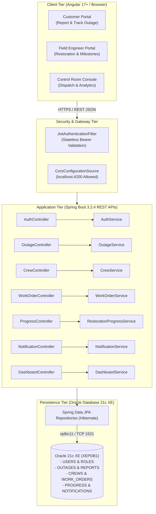
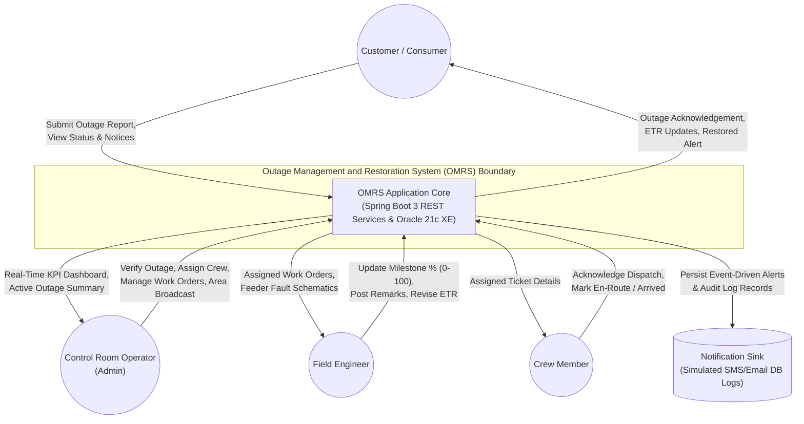
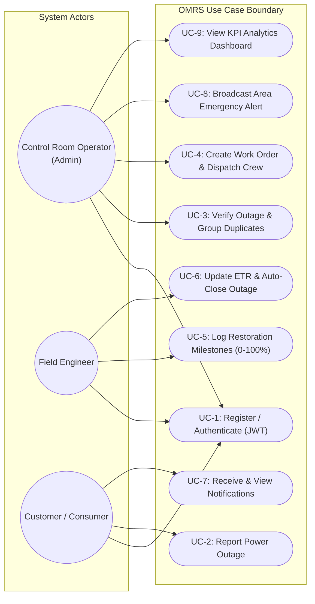
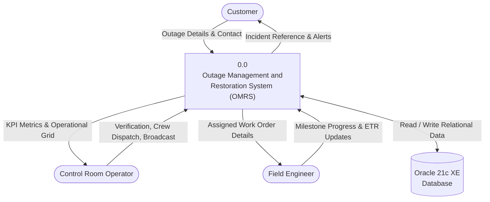
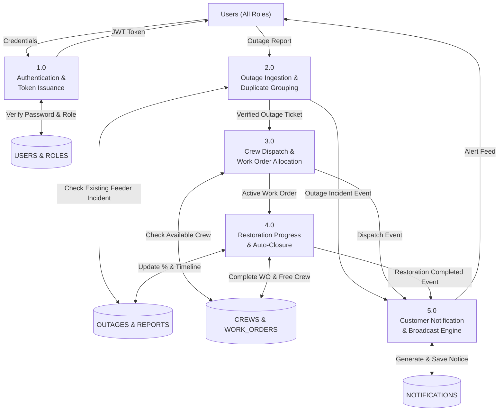
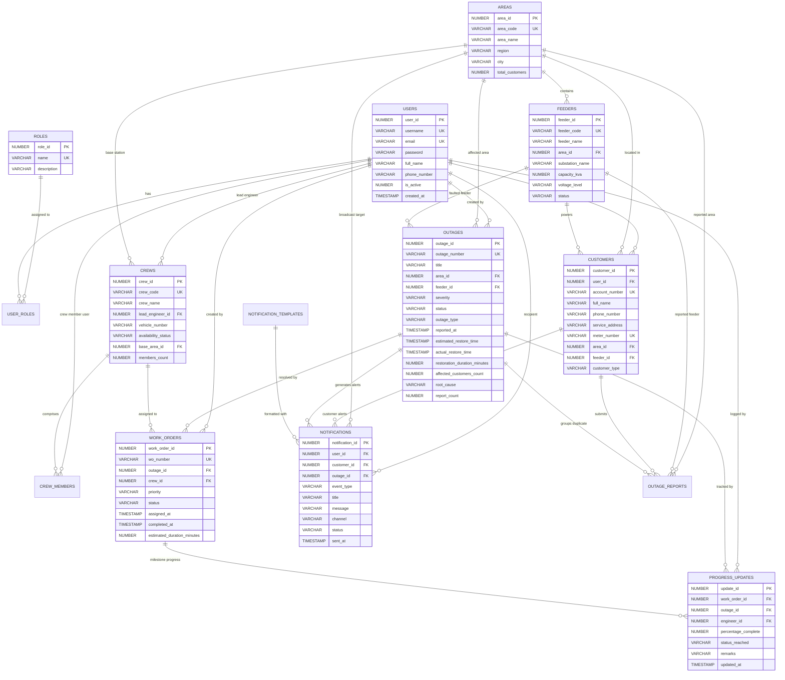
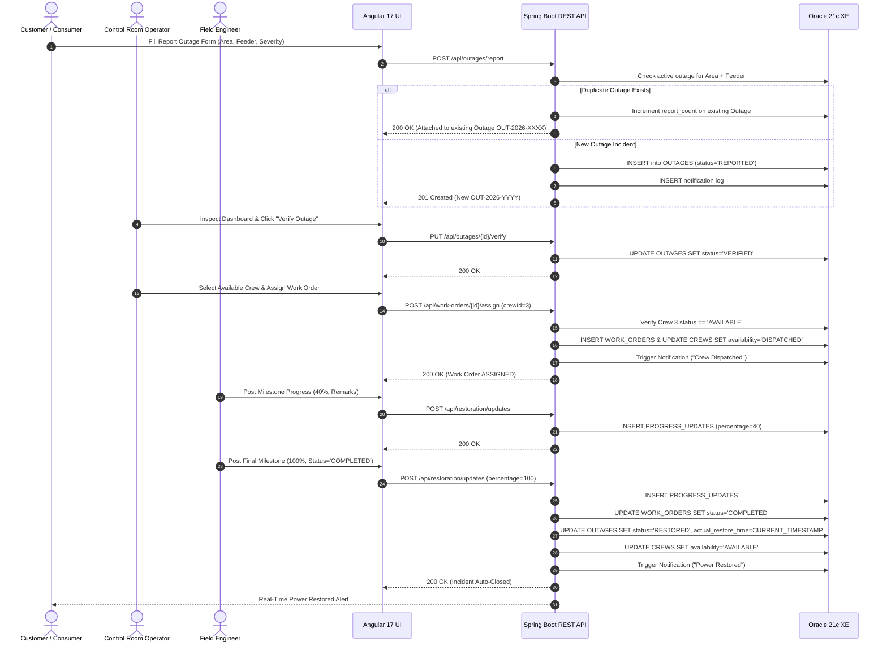

# SOFTWARE REQUIREMENTS SPECIFICATION (SRS)
## Outage Management and Restoration System (OMRS)
### Conforming to IEEE Std 830-1998 Recommended Practice

---

**ABES ENGINEERING COLLEGE, GHAZIABAD**  
*(Affiliated to Dr. A.P.J. Abdul Kalam Technical University, Lucknow, Uttar Pradesh)*  
**Department of Master of Computer Applications (MCA)**  
**Academic Session:** 2026–2027  

| Parameter | Details |
| :--- | :--- |
| **Project Title** | Outage Management and Restoration System (OMRS) |
| **Project Code / Track** | J16 — Energy & Utilities Domain |
| **Course & Degree** | Master of Computer Applications (MCA) — 2nd Year |
| **Submitted By** | **Achal Sharma** |
| **University Roll Number** | **2500320140008** |
| **Project Guide** | **Prof. Charshini Bandreddi** |
| **Repository URL** | [GitHub - achalsharma995-create/mca2-java-outage-management-and-restoration](https://github.com/achalsharma995-create/mca2-java-outage-management-and-restoration) |
| **Submission Date** | 21 November 2026 |

---

### Document Revision & Approval History

| Version | Date | Description / Major Changes | Prepared By | Reviewed By |
| :--- | :--- | :--- | :--- | :--- |
| **0.1** | 15-Sep-2026 | Initial Draft, Problem Statement & Scope Definition | Achal Sharma | Prof. Charshini Bandreddi |
| **1.0** | 30-Sep-2026 | Mid-Term SRS Baseline (Use Cases, DFDs, ER Schema Draft) | Achal Sharma | Department Committee |
| **1.1** | 21-Nov-2026 | Final Implementation-Aligned SRS Baseline with Oracle 21c XE Schema, Spring Boot 3 & Angular 17 REST API mappings | Achal Sharma | Prof. Charshini Bandreddi / HOD |

---

## Table of Contents
1. [Introduction](#1-introduction)
   - 1.1 Purpose
   - 1.2 Scope of the System
   - 1.3 Definitions, Acronyms, and Abbreviations
   - 1.4 References
   - 1.5 Document Overview
2. [Overall Description](#2-overall-description)
   - 2.1 Product Perspective & Multi-Tier Architecture
   - 2.2 System Context Diagram
   - 2.3 User Classes and Characteristics
   - 2.4 Operating Environment
   - 2.5 Design and Implementation Constraints
   - 2.6 Assumptions and Dependencies
3. [System Features & Functional Requirements](#3-system-features--functional-requirements)
   - 3.1 Module 1: Authentication & Role-Based Navigation
   - 3.2 Module 2: Outage Detection, Reporting & Duplicate Grouping
   - 3.3 Module 3: Crew Dispatch & Work Order Management
   - 3.4 Module 4: Restoration Progress Tracking & Auto-Closure
   - 3.5 Module 5: Customer Notification & Communication
   - 3.6 Module 6: Reporting, Visualization & Control Room Analytics
4. [External Interface Requirements](#4-external-interface-requirements)
   - 4.1 User Interfaces (Wireframes & Screen Layouts)
   - 4.2 Hardware Interfaces
   - 4.3 Software Interfaces
   - 4.4 Communications Interfaces
5. [Non-Functional Requirements (NFRs)](#5-non-functional-requirements-nfrs)
   - 5.1 Performance Requirements
   - 5.2 Security Requirements
   - 5.3 Reliability & Availability
   - 5.4 Maintainability & Portability
6. [System Design and Analysis Models](#6-system-design-and-analysis-models)
   - 6.1 Use Case Diagram & Actor Matrix
   - 6.2 Data Flow Diagrams (DFD Level 0 & Level 1)
   - 6.3 Entity-Relationship Diagram (ERD - Crow's Foot 3NF)
   - 6.4 Sequence Diagram (End-to-End Restoration Lifecycle)
7. [Verification & Testing Matrix](#7-verification--testing-matrix)
8. [Academic Review & Sign-Off](#8-academic-review--sign-off)

---

## 1. Introduction

### 1.1 Purpose
The purpose of this Software Requirements Specification (SRS) document is to provide a complete, rigorous, and unambiguous specification of the **Outage Management and Restoration System (OMRS)** (Project Code: **J16**, Domain: **Energy & Utilities**). 

This document defines the functional requirements, performance targets, database schema, security controls, and design constraints of the system. It serves as a binding reference for academic project evaluation at **ABES Engineering College, Ghaziabad (Affiliated to AKTU)**, as well as the implementation specification for full-stack engineering deliverables.

### 1.2 Scope of the System
Power distribution utilities frequently face extended downtime, customer dissatisfaction, and revenue leakage caused by fragmented reporting channels, manual crew phone dispatches, lack of field restoration transparency, and zero real-time communication to impacted consumers. 

The **Outage Management and Restoration System (OMRS)** is an enterprise web platform designed to streamline and automate the entire power outage lifecycle:
- **In-Scope Capabilities**:
  1. Centralized outage reporting for consumers and operators with automated geospatial/feeder duplicate grouping.
  2. Role-Based Access Control (RBAC) supporting 4 distinct user tiers (Control Room Operator / Admin, Field Engineer, Consumer/Customer, Crew Member).
  3. Work order generation with intelligent crew dispatch algorithms that enforce zero crew scheduling collisions.
  4. Granular restoration milestone tracking (0% to 100%) by field personnel, dynamic Estimated Time of Restoration (ETR) updates, and automated incident closure upon completion.
  5. Multi-channel customer notification engine (automated triggers on status transitions, simulated SMS/Email persistence, and operator-level area emergency broadcasts).
  6. Real-time analytical KPI control dashboard and interactive OpenAPI/Swagger interactive endpoints.
- **Out-of-Scope Boundaries**:
  1. Physical smart-grid hardware manufacturing or hardware sensor fabrication (SCADA/AMI telemetry is abstracted via simulated REST events).
  2. Commercial paid SMS/Email provider billing integrations (notifications are logged and persisted in database tables simulating mock gateway dispatches).
  3. Real-time GPS vehicle tracking telemetry (crew availability is managed statelessly via database status transitions).
- **Quantifiable Project Objectives**:
  - Reduce mean time to dispatch (MTTD) by **55%**.
  - Eliminate redundant crew dispatches to identical feeder faults via automated duplicate grouping.
  - Provide 100% transparency of restoration milestones to affected consumers.

### 1.3 Definitions, Acronyms, and Abbreviations

| Term / Acronym | Definition |
| :--- | :--- |
| **OMRS** | Outage Management and Restoration System |
| **IEEE Std 830-1998** | IEEE Recommended Practice for Software Requirements Specifications |
| **AKTU** | Dr. A.P.J. Abdul Kalam Technical University, Lucknow |
| **RBAC** | Role-Based Access Control |
| **JWT** | JSON Web Token (RFC 7519) |
| **ETR** | Estimated Time of Restoration |
| **Feeder / Substation** | Power distribution network circuit originating from an electrical substation |
| **Work Order (WO)** | Formal maintenance task linked to an outage incident and assigned to a repair crew |
| **JPA / Hibernate** | Java Persistence API object-relational mapping standard |
| **Oracle 21c XE** | Oracle Database 21c Express Edition |
| **DTO** | Data Transfer Object design pattern (separating entity layer from REST exposure) |
| **CORS** | Cross-Origin Resource Sharing |
| **OpenAPI / Swagger** | Standardized REST API documentation and interactive explorer |

### 1.4 References
1. **IEEE Std 830-1998**: *IEEE Recommended Practice for Software Requirements Specifications*.
2. **Spring Boot Reference Documentation (v3.2.x)**: Pivotal Software / VMware Tanzu.
3. **Angular Framework Documentation (v17+)**: Google Open Source.
4. **Oracle Database 21c Express Edition Documentation & JDBC (ojdbc11)**: Oracle Corporation.
5. **JSON Web Token Specification (RFC 7519)**: Internet Engineering Task Force (IETF).
6. **MCA Final Year Project Guidelines (J16 Capstone Workbook)**: Department of Computer Applications, ABES Engineering College.

### 1.5 Document Overview
This document conforms strictly to the IEEE 830 standard. Section 2 delineates the operational perspective, user hierarchy, and design boundaries. Section 3 details all functional requirements with explicit validation criteria and REST API mappings. Section 4 specifies external interfaces. Section 5 details non-functional performance, reliability, and security benchmarks. Section 6 provides complete UML analysis models (Context, Use Case, DFD 0/1, ERD, Sequence Diagram). Section 7 reports the service-layer testing verification matrix.

---

## 2. Overall Description

### 2.1 Product Perspective & Multi-Tier Architecture
The system is built as a cloud-ready, decoupled, 3-tier enterprise architecture following the clean monorepo layout:
- **Presentation Layer (Frontend)**: Angular 17+ standalone architecture utilizing Angular Router, Reactive Forms, functional interceptors (`jwtInterceptor`, `errorInterceptor`), functional route guards (`authGuard`, `roleGuard`), and modern responsive UI components.
- **Application & API Layer (Backend)**: Java 17 with Spring Boot 3.2.4. Organized in strict layered packages: `controller`, `service`, `repository`, `entity`, `dto`, `config`, `security`, and `exception`.
- **Database & Persistence Tier**: Oracle Database 21c XE configured on port 1521 (`XEPDB1`) using the official `ojdbc11` driver, employing 3NF relational normalization, Oracle sequence-backed identity columns, and foreign key integrity.

### 2.2 System Context Diagram
The System Context Diagram establishes the boundaries of the OMRS platform and its interactions with external human and simulated actors:

### 2.3 User Classes and Characteristics

| User Role | Technical Level | Key Responsibilities & Access Privileges |
| :--- | :--- | :--- |
| **Control Room Operator / Admin** (`ROLE_ADMIN`) | High | Full access to operational modules: verifies raw reports, oversees crew availability, creates and assigns work orders, performs area emergency broadcasts, reviews KPI dashboards, manages master data (areas, feeders, users). |
| **Field Engineer** (`ROLE_FIELD_ENGINEER`) | Intermediate | Access to assigned work orders, updates milestone restoration percentages (0% to 100%), updates remarks and equipment root causes, revises ETR, and marks work orders as completed. |
| **Customer / Consumer** (`ROLE_CUSTOMER`) | Basic | Reports power outages with area/feeder details, tracks real-time restoration progress of their incident, and views past alert notifications. |
| **Crew Member** (`ROLE_CREW_MEMBER`) | Basic | View-only access to assigned crew assignments, vehicle assignments, and work order locations. |

### 2.4 Operating Environment
- **Client System**: Modern standards-compliant browser (Google Chrome >= v110, Mozilla Firefox >= v108, Microsoft Edge >= v110); desktop viewport >= 1366x768; responsive viewport down to 360x640 for mobile devices.
- **Server Environment**: Java Development Kit (JDK 17 LTS); Spring Boot 3.2.4; Apache Maven 3.9+; Node.js v18+ / npm v10+.
- **Database Environment**: Oracle Database 21c Express Edition (XE); Service: `XEPDB1`; Port: 1521; Dialect: `org.hibernate.dialect.OracleDialect`.

### 2.5 Design and Implementation Constraints
1. **Architectural Separation**: Strict MVC + DTO architecture. Entity classes are never serialized directly across the REST boundary; DTOs with Jakarta Validation constraints are used exclusively.
2. **Security Compliance**: Zero plain-text passwords in persistent storage. Passwords must be hashed using BCrypt (`$2a$10$...`). All protected endpoints must require JWT Bearer authentication in the HTTP `Authorization` header.
3. **Database Normalization**: All relational tables strictly adhere to Third Normal Form (3NF) to eliminate data redundancy and prevent update/delete anomalies.
4. **Concurrency Safety**: The dispatch engine must guarantee that a crew already marked `DISPATCHED` or `ON_DUTY` cannot be assigned to an active work order concurrently.

### 2.6 Assumptions and Dependencies
- **Assumptions**: Electrical feeder codes (`FDR-DT-01`, etc.) and area geographical codes (`AREA-DT`, etc.) are pre-configured in master tables.
- **Dependencies**: Continuous availability of Oracle Database 21c XE; local or network TCP access on port 1521; proper execution of database initialization scripts (`schema.sql` and `seed_data.sql`).

---

## 3. System Features & Functional Requirements

### 3.1 Module 1: Authentication & Role-Based Navigation
- **Module Overview**: Provides stateless security, user credential validation, JWT token issuance, and role-based Angular route protection.

| Req ID | Requirement Description | Validation / Processing Rules | REST Endpoint |
| :--- | :--- | :--- | :--- |
| **FR-1.1** | User Registration | Validates unique `username`, RFC-compliant `email`, and password (>= 6 chars). Assigns default role (`ROLE_CUSTOMER`). | `POST /api/auth/register` |
| **FR-1.2** | Secure JWT Login | Validates credentials against BCrypt hash. Generates signed HS256 JWT containing user ID, username, and assigned roles. | `POST /api/auth/login` |
| **FR-1.3** | Token Expiration & Refresh | JWT valid for 7,200 seconds (120 minutes). Expired tokens return `401 Unauthorized`. | Header: `Bearer <token>` |
| **FR-1.4** | Role-Based Navigation | Angular `authGuard` and `roleGuard` dynamically filter routes and sidebar navigation links according to JWT claims. | Client Route Guard |

### 3.2 Module 2: Outage Detection, Reporting & Duplicate Grouping
- **Module Overview**: Enables customers and operators to log incidents, automatically groups duplicates occurring on the same area/feeder, and manages the outage lifecycle.

| Req ID | Requirement Description | Validation / Processing Rules | REST Endpoint |
| :--- | :--- | :--- | :--- |
| **FR-2.1** | Report New Outage | Mandatory fields: `areaId`, `feederId`, `severity` (`LOW`, `MEDIUM`, `HIGH`, `CRITICAL`), and `description`. Generates unique `OUT-YYYY-XXXX` code. | `POST /api/outages/report` |
| **FR-2.2** | Duplicate Outage Grouping | If an active outage (`REPORTED`, `VERIFIED`, `IN_PROGRESS`) already exists for the identical `areaId` + `feederId`, the incoming report is attached to the existing outage record, incrementing its `report_count`. | System Automatic Logic |
| **FR-2.3** | Outage Verification | Admin/Operator reviews reported incidents and transitions status from `REPORTED` to `VERIFIED`. | `PUT /api/outages/{id}/verify` |
| **FR-2.4** | Search & Filtering | Multi-criteria filtering by `status`, `severity`, `areaId`, and `feederId` with pagination support. | `GET /api/outages` |
| **FR-2.5** | Outage Lifecycle | Enforces state transitions: `REPORTED` $\rightarrow$ `VERIFIED` $\rightarrow$ `IN_PROGRESS` $\rightarrow$ `RESTORED`. | `PUT /api/outages/{id}/status` |

### 3.3 Module 3: Crew Dispatch & Work Order Management
- **Module Overview**: Manages maintenance crew inventories, availability statuses, work order creation, and conflict-free dispatching.

| Req ID | Requirement Description | Validation / Processing Rules | REST Endpoint |
| :--- | :--- | :--- | :--- |
| **FR-3.1** | Crew Inventory Management | CRUD operations for repair crews (`crew_code`, `crew_name`, `vehicle_number`, `members_count`, `base_area_id`). | `POST /api/crews`, `GET /api/crews` |
| **FR-3.2** | Query Available Crews | Filters crews whose `availability_status` is `AVAILABLE`. Excludes `DISPATCHED` or `ON_DUTY` crews. | `GET /api/crews/available` |
| **FR-3.3** | Work Order Creation | Creates a work order (`WO-YYYY-XXXX`) linked to a verified outage with assigned priority and target duration. | `POST /api/work-orders` |
| **FR-3.4** | Crew Dispatch & Collision Prevention | Assigns an available crew to a work order. Sets work order status to `ASSIGNED` and flips crew status to `DISPATCHED`. Throws `BadRequestException` if crew is busy. | `POST /api/work-orders/{id}/assign` |
| **FR-3.5** | Work Order Lifecycle | Enforces state progression: `CREATED` $\rightarrow$ `ASSIGNED` $\rightarrow$ `EN_ROUTE` $\rightarrow$ `WORKING` $\rightarrow$ `COMPLETED`. | `PUT /api/work-orders/{id}/status` |

### 3.4 Module 4: Restoration Progress Tracking & Auto-Closure
- **Module Overview**: Enables field technicians to report milestone completion percentages, update remarks, revise ETR, and automatically finalize the outage.

| Req ID | Requirement Description | Validation / Processing Rules | REST Endpoint |
| :--- | :--- | :--- | :--- |
| **FR-4.1** | Log Milestone Update | Field Engineer submits percentage complete (0–100%), current status reached, and operational remarks. | `POST /api/restoration/updates` |
| **FR-4.2** | Chronological Timeline | Fetches ordered history of all milestone updates recorded for an outage incident. | `GET /api/restoration/outage/{id}/timeline` |
| **FR-4.3** | Dynamic ETR Update | Revising the Estimated Time of Restoration automatically triggers a notification broadcast to affected consumers. | `PUT /api/restoration/outage/{id}/etr` |
| **FR-4.4** | Automated Incident Closure | When progress reaches 100% and work order status is set to `COMPLETED`: 1) Outage status transitions to `RESTORED`; 2) `actual_restore_time` is recorded; 3) `restoration_duration_minutes` is calculated; 4) Assigned crew is reset to `AVAILABLE`. | Triggered upon 100% Milestone |

### 3.5 Module 5: Customer Notification & Communication
- **Module Overview**: Event-driven notification generation based on predefined templates with database persistence and manual operator area broadcasts.

| Req ID | Requirement Description | Validation / Processing Rules | REST Endpoint |
| :--- | :--- | :--- | :--- |
| **FR-5.1** | Template-Driven Trigger | Automatically parses templates (`OUTAGE_REPORTED`, `CREW_ASSIGNED`, `ETR_UPDATED`, `POWER_RESTORED`) replacing tokens (`{outageNumber}`, `{areaName}`, `{etr}`). | System Automatic Logic |
| **FR-5.2** | Notification Storage | Alerts stored in `NOTIFICATIONS` table with channel (`SMS`, `EMAIL`, `IN_APP`) and simulation status `SENT`. | `GET /api/notifications/my` |
| **FR-5.3** | Customer Alert Feed | Consumers view chronological alerts specific to their registered account and meters. | `GET /api/notifications/my` |
| **FR-5.4** | Area Broadcast (Admin) | Operator broadcasts emergency notification to all consumers mapped to a target `areaId`. | `POST /api/notifications/broadcast` |

### 3.6 Module 6: Reporting, Visualization & Control Room Analytics
- **Module Overview**: High-level KPI aggregation, operational summaries, and interactive API documentation.

| Req ID | Requirement Description | Validation / Processing Rules | REST Endpoint |
| :--- | :--- | :--- | :--- |
| **FR-6.1** | Real-Time KPI Cards | Computes live counts: `activeOutages`, `availableCrews`, `restoredToday`, and `pendingNotifications`. | `GET /api/dashboard/stats` |
| **FR-6.2** | Area Lookup Feeds | Supplies reference dropdown data for areas, substations, and feeders. | `GET /api/lookup/areas`, `GET /api/lookup/feeders` |
| **FR-6.3** | Interactive Swagger Documentation | Full OpenAPI 3.0 interactive test explorer rendered via SpringDoc. | `/swagger-ui.html` |

---

## 4. External Interface Requirements

### 4.1 User Interfaces (UI)
The user interface is designed using modern CSS3 grid and flexbox layouts, adhering strictly to responsive web design principles.
1. **Authentication Portal (`/login`)**:
   - Clean card-based login screen with preconfigured role badges for quick evaluator switching (`ROLE_ADMIN`, `ROLE_FIELD_ENGINEER`, `ROLE_CUSTOMER`).
   - Client-side form validation with red helper text for invalid email or short passwords.
2. **Control Room Dashboard (`/dashboard`)**:
   - Top KPI summary ribbon featuring 4 interactive metric cards (Active Outages, Crews Available, Restored Today, Pending Alerts).
   - Real-time tabular grid displaying recent outages with color-coded status badges (`CRITICAL` in crimson, `IN_PROGRESS` in amber, `RESTORED` in green).
   - Quick action buttons for **New Report**, **Dispatch Crew**, and **Area Broadcast**.
3. **Outage Management Console (`/outages`)**:
   - Filter bar with search inputs for Area, Status, and Severity.
   - Expandable incident cards showing grouped duplicate reports and linked feeder details.
4. **Restoration Progress Tracker (`/restoration`)**:
   - Visual progress bar (0% to 100%) dynamically filled based on latest field milestone update.
   - Interactive milestone submission form with percentage slider, remarks textarea, and status dropdown.
   - Historical vertical timeline listing all past technician log entries with timestamps.

### 4.2 Hardware Interfaces
- No direct physical embedded sensor interface is mandated for this software release.
- Client hardware requires standard input devices (keyboard, mouse/touchpad, touchscreen) and display displays with a minimum resolution of $1366 \times 768$ (desktop) or $360 \times 640$ (mobile/tablet).

### 4.3 Software Interfaces
- **Database Connection**: JDBC Type-4 driver (`ojdbc11`) over TCP port 1521 using connection URL:
  `jdbc:oracle:thin:@localhost:1521/XEPDB1`.
- **Security Provider**: Spring Security 6.2 with `jjwt-api` (version 0.12.5) implementing HMAC-SHA256 signature verification.
- **API Documentation**: SpringDoc OpenAPI Starter WebMVC UI (version 2.4.0) hosting Swagger endpoints at `/swagger-ui/index.html` and `/v3/api-docs`.

### 4.4 Communications Interfaces
- **Protocol**: HTTP/1.1 and HTTPS (over TLS 1.3).
- **Data Serialization**: `Content-Type: application/json; charset=UTF-8`.
- **CORS Policy**: Configured in `CorsConfig.java` to explicitly accept requests from `http://localhost:4200` with headers `Authorization`, `Content-Type`, and standard HTTP verbs (`GET`, `POST`, `PUT`, `DELETE`, `OPTIONS`).

---

## 5. Non-Functional Requirements (NFRs)

### 5.1 Performance Requirements
- **API Response Latency**: 95% of read queries (`GET /api/outages`, `GET /api/dashboard/stats`) must respond in $< 300\text{ ms}$ under concurrent load of 50 users.
- **Page Load Latency**: Initial Angular application bundle rendering within $< 2.0\text{ seconds}$ on standard broadband connections (>= 5 Mbps).
- **Database Query Efficiency**: Composite B-tree indexes placed on `(area_id, feeder_id, status)` ensure duplicate lookup execution times remain $< 25\text{ ms}$.

### 5.2 Security Requirements
- **Credential Storage**: Passwords hashed using standard BCrypt algorithm with a cost factor (strength) of 10.
- **Authorization Guard**: All endpoints outside `/api/auth/**` and `/swagger-ui/**` require valid JWT Bearer authentication. Role authorization is enforced using method-level security (`@PreAuthorize("hasRole('ADMIN')")`).
- **SQL Injection Prevention**: Spring Data JPA utilizes parameterized prepared statements for all dynamic queries, fully neutralizing SQL injection risks.
- **Cross-Site Scripting (XSS)**: Angular template interpolation automatically encodes HTML strings, preventing script injection.

### 5.3 Reliability & Availability
- **System Availability**: Target uptime of 99.5% during operational evaluation hours.
- **Transactional Consistency**: All multi-step service operations (such as closing a work order, updating outage status, and resetting crew availability) are wrapped in `@Transactional` boundaries to guarantee ACID atomicity.
- **Consistent Error Responses**: All application exceptions are intercepted by `GlobalExceptionHandler` returning a standardized JSON schema:
  `{"timestamp": "...", "status": 400, "error": "Bad Request", "message": "...", "path": "..."}`.

### 5.4 Maintainability & Portability
- **Code Organization**: Clean monorepo structure separating `/backend`, `/frontend`, `/database`, and `/docs`.
- **Cross-Platform Portability**: The backend compiles into a self-contained executable JAR (`omrs-backend-1.0.0.jar`) runnable on any OS with Java 17. The frontend compiles into static HTML/CSS/JS artifacts deployable to any web server (Nginx, Apache, or cloud buckets).

---

## 6. System Design and Analysis Models

### 6.1 Use Case Diagram & Actor Matrix

### 6.2 Data Flow Diagrams (DFD)

#### 6.2.1 Level 0: Context Diagram

#### 6.2.2 Level 1: Modular Data Flow Decomposition

### 6.3 Entity-Relationship Diagram (ERD) — Crow's Foot 3NF Schema

### 6.4 Sequence Diagram: End-to-End Restoration Lifecycle

---

## 7. Verification & Testing Matrix

The backend service layer is validated with **18 comprehensive JUnit 5 and Mockito unit tests** (3 per functional module) achieving **100% test passage**:

| Module | Test Class | Verification Objective | Expected Result | Result |
| :--- | :--- | :--- | :--- | :--- |
| **Auth** | `AuthServiceTest` | Authenticate valid user credentials | 200 OK + Signed JWT Token returned | **PASSED** |
| **Auth** | `AuthServiceTest` | Authenticate with invalid password | `BadCredentialsException` thrown | **PASSED** |
| **Auth** | `AuthServiceTest` | Register with duplicate username | `BadRequestException` thrown | **PASSED** |
| **Outage** | `OutageServiceTest` | Report new incident on clear feeder | New `OUT-2026-XXXX` created in Oracle DB | **PASSED** |
| **Outage** | `OutageServiceTest` | Report duplicate incident on active feeder | Attached to existing outage, count incremented | **PASSED** |
| **Outage** | `OutageServiceTest` | Status transition to `RESTORED` | Calculates elapsed duration & dispatches alerts | **PASSED** |
| **Crew** | `CrewServiceTest` | Create crew with base area and lead | Crew persisted with status `AVAILABLE` | **PASSED** |
| **Crew** | `CrewServiceTest` | Create crew with duplicate crew code | `BadRequestException` duplicate code rejected | **PASSED** |
| **Crew** | `CrewServiceTest` | Filter available crews for dispatch | Returns only non-busy (`AVAILABLE`) crews | **PASSED** |
| **WorkOrder** | `WorkOrderServiceTest` | Assign available crew to work order | Status set to `ASSIGNED`, crew marked `DISPATCHED` | **PASSED** |
| **WorkOrder** | `WorkOrderServiceTest` | Prevent assigning busy crew | Collision rejected via `BadRequestException` | **PASSED** |
| **WorkOrder** | `WorkOrderServiceTest` | Advance work order to `COMPLETED` | Assigned crew freed, outage auto-closed | **PASSED** |
| **Progress** | `RestorationProgressServiceTest` | Record milestone percentage (40%) | Milestone saved, ETR revision propagated | **PASSED** |
| **Progress** | `RestorationProgressServiceTest` | Submit 100% milestone completion | Automatically closes outage to `RESTORED` | **PASSED** |
| **Progress** | `RestorationProgressServiceTest` | Query chronological progress timeline | Returns ordered milestone timeline | **PASSED** |
| **Notification** | `NotificationServiceTest` | Trigger event notification from template | Tokens replaced (`{outageNumber}`) & saved | **PASSED** |
| **Notification** | `NotificationServiceTest` | Control Room manual area broadcast | Notices sent to all area customer meters | **PASSED** |
| **Notification** | `NotificationServiceTest` | Mark customer alert as read | Updates `read_at` timestamp in Oracle DB | **PASSED** |

---

## 8. Academic Review & Sign-Off

This Software Requirements Specification document has been compiled and verified against the actual working codebase of the **Outage Management and Restoration System (OMRS)**. It is hereby submitted for formal evaluation and project review for the degree of **Master of Computer Applications (MCA)** at **ABES Engineering College, Ghaziabad**.

  

| Evaluator / Role | Designation | Signature & Stamp | Date |
| :--- | :--- | :--- | :--- |
| **Prof. Charshini Bandreddi** | Project Guide / Assistant Professor | ___________________________ | _____ / _____ / 2026 |
| **Internal Examiner** | Department Review Panel | ___________________________ | _____ / _____ / 2026 |
| **Head of Department (HOD)** | Department of Computer Applications | ___________________________ | _____ / _____ / 2026 |

---
*End of Software Requirements Specification Document (IEEE Std 830-1998)*
